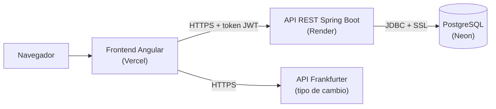
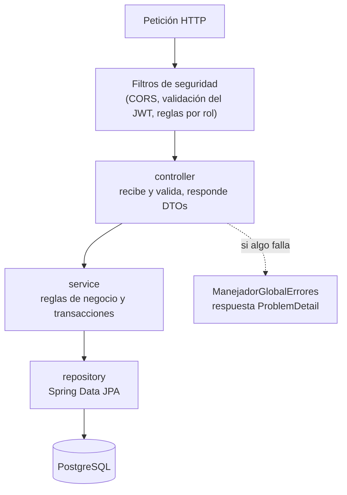
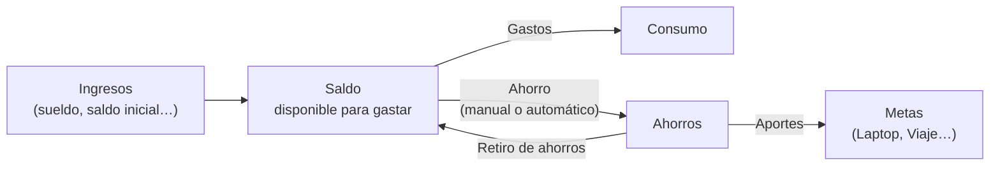
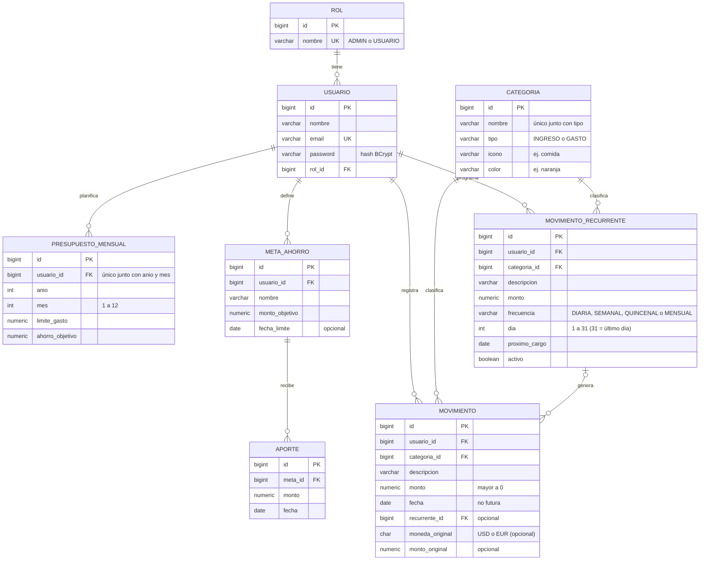

# GAMS Finanzas — Backend

API REST de **GAMS Finanzas**, una aplicación de finanzas personales para jóvenes y universitarios que
no llevan el control de sus gastos. Proyecto del curso **Desarrollo Full Stack** (UTP).

Frontend (Angular): <https://github.com/DiegoPorrasZela/GAMS-Finanzas>

## Tecnologías

- Java 21 y Spring Boot 4.1 (Web MVC, Data JPA, Validation)
- Spring Security con tokens JWT (HMAC-SHA256) y contraseñas con BCrypt
- PostgreSQL (Neon en la nube) con migraciones Flyway
- Maven (incluye `mvnw`, no hace falta instalarlo)

## Arquitectura



El backend sigue una **arquitectura en capas**: cada capa solo conoce a la de abajo.



```
controller/   Endpoints REST: reciben y validan la petición, devuelven DTOs
service/      Lógica y reglas de negocio, transacciones
repository/   Acceso a datos con Spring Data JPA
entity/       Tablas de la base de datos mapeadas con JPA
dto/          Objetos que entran y salen del API (nunca se expone una entidad)
exception/    Errores del negocio y su conversión a respuestas JSON (ProblemDetail)
config/       Seguridad (JWT, roles, CORS) y datos iniciales
```

## Seguridad

- **Autenticación:** `POST /api/auth/login` (o `/registro`) devuelve un **token JWT** firmado que dura 8 horas.
  El cliente lo envía en cada petición con el header `Authorization: Bearer <token>`. El servidor no guarda
  sesiones (stateless): la sesión es el token, y cerrar sesión es descartarlo.
- **Autorización por rol:** el token lleva el rol del usuario. `USUARIO` gestiona sus movimientos y ve las
  categorías; `ADMIN` además crea, edita y elimina categorías y gestiona usuarios.
- **Autorización por dueño:** el id del usuario sale del token, nunca del cuerpo de la petición. Un movimiento
  de otro usuario responde `404`, como si no existiera.
- Las contraseñas se guardan con **BCrypt**. Un token alterado (por ejemplo, cambiando el rol) se rechaza
  porque su firma deja de ser válida.
- Ningún secreto está en el repositorio: la conexión a la base de datos, la clave de los tokens y la
  contraseña del administrador llegan por variables de entorno.

## Reglas de negocio

### Flujo del dinero



- El **ahorro** sale del saldo y se ve en Movimientos, pero **no cuenta como gasto**: no afecta el presupuesto
  ni el gráfico por categoría; cuenta como "ahorro del mes".
- El **saldo inicial** y los **retiros de ahorros** entran al saldo, pero no son ingresos ganados en el mes.

| Regla | Dónde se valida | Por qué |
|---|---|---|
| Un usuario solo ve y modifica sus propios datos | Servicios (el id sale del token) | Privacidad: lo ajeno responde 404 |
| Los movimientos y aportes no pueden tener fecha futura (sí pasada) | DTO (`@PastOrPresent`) y front | Se puede registrar un gasto olvidado, pero no inventar uno que no ocurrió |
| La fecha límite de una meta no puede estar en el pasado | DTO (`@FutureOrPresent`) y front | Una meta es un objetivo a futuro |
| Los aportes a metas salen de los ahorros libres (separado − retirado − aportado): no se puede aportar más | `MetaAhorroService` y front | No se puede guardar para una meta dinero que no se separó |
| Una meta no recibe más de lo que le falta, y su objetivo no puede bajar de lo ya ahorrado | `MetaAhorroService` y front | Una meta cumplida está cumplida: no tiene sentido pasar del 100 % |
| No se puede retirar de los ahorros más de lo libre (lo que está en metas no se retira) | `MovimientoService` y front | Primero se quita el aporte de la meta |
| Los ahorros nunca quedan en negativo: borrar o rebajar un ahorro cuyo dinero ya está en una meta se rechaza | `AhorroService` (se valida después del cambio y la transacción se deshace) | El dinero de las metas tiene que haber salido de algún ahorro |
| Separar a ahorros más de lo que hay en el saldo se avisa, no se bloquea | Front | Igual que un gasto: la app registra la realidad |
| Los retiros de ahorros no pueden ser automáticos | `RecurrenteService` | Retirar es una decisión puntual (una emergencia) |
| Un gasto que deja el saldo en negativo **se avisa, no se bloquea** | Front (confirmación) e Inicio (alerta) | La app registra la realidad: si el gasto ocurrió (ej. con tarjeta), bloquearlo haría perder el control |
| El saldo inicial (dinero con el que se empieza) se registra **una sola vez** por usuario y no puede ser automático; si cambia, se edita | `MovimientoService`, `RecurrenteService` y front | Es un punto de partida, no un ingreso que se repite |
| "Saldo inicial", "Ahorro" y "Retiro de ahorros" son categorías del sistema: no se pueden renombrar, eliminar ni duplicar | `CategoriaService` | Si el admin las cambiara, las reglas de saldo inicial y ahorros dejarían de funcionar |
| Los automáticos (diarios, semanales, quincenales o mensuales) se registran al llegar su fecha, sin duplicarse | `RecurrenteService` (bloqueo `FOR UPDATE`) | Dos peticiones a la vez no pueden registrar la misma fecha dos veces |
| Meses de distinto largo: si el día elegido no existe (29, 30, 31) se usa el último día del mes y el mes siguiente vuelve al día elegido; el día 31 es "último día del mes" y la quincena es el 15 y el último día | `MovimientoRecurrente` (probado con `MovimientoRecurrenteTest`) | Un sueldo de fin de mes debe llegar el 28, 29, 30 o 31 según el mes |
| Un automático se puede programar a futuro: su primer registro es la primera fecha del calendario desde el día indicado | `MovimientoRecurrente` | Ej. creado el 9 con pago el 15, el primero llega el 15 |
| Al reanudar un automático no se registran los meses en pausa | `MovimientoRecurrente.reanudar()` | Pausar significa que esos meses no hubo ese ingreso o gasto |
| No se puede borrar ni cambiar de tipo una categoría con movimientos | `CategoriaService` | Cambiaría el historial de los usuarios |
| El presupuesto avisa si límite + ahorro supera los ingresos del mes | Front | Ayuda a planificar algo que sí se puede cumplir |
| Un pago en dólares o euros guarda el monto en soles **y** el monto y la moneda originales (los dos o ninguno); solo USD y EUR | `MovimientoRequest`, `MovimientoService` y restricciones `CHECK` en la base | Se ve "US$ 10.00" tal como se pagó, pero todos los totales siguen en soles |
| El saldo inicial y los ahorros se registran siempre en soles | `MovimientoService` | Son movimientos internos del dinero del usuario |
| Cada categoría tiene un ícono y un color de una lista fija (si no se indican: etiqueta gris; al editar sin indicarlos se conservan) | `CategoriaRequest` (`@Pattern` con `Categoria.ICONOS` y `Categoria.COLORES`) | El frontend sabe dibujar solo esos íconos y colores |
| No se puede borrar ni cambiar de tipo una categoría usada por un automático (aunque aún no tenga movimientos) | `CategoriaService` | El automático cambiaría de gasto a ingreso sin aviso |
| Máximo 5 contraseñas equivocadas por correo e IP cada 15 minutos, y 20 cuentas nuevas por IP cada hora (responde `429`) | `LimiteIntentos` y `AuthService` | Frena a quien intenta adivinar contraseñas o crear cuentas en masa |
| El token de una cuenta eliminada deja de servir al instante | `JwtConfig` (validador del token) | Sin esto seguiría entrando hasta que el token venza (8 horas) |
| "Hoy" se calcula con la hora de Perú (`America/Lima`) | `GamsFinanzasApplication` | El servidor en la nube usa UTC |

## Patrones de diseño

| Patrón | Dónde se usa | Para qué |
|---|---|---|
| Arquitectura en capas (MVC) | `controller` → `service` → `repository` | Cada capa tiene una sola responsabilidad |
| Repository | `repository/*Repository` (Spring Data JPA) | Acceder a los datos sin escribir SQL en la lógica |
| DTO | `dto/*Request`, `dto/*Response` | No exponer las entidades ni la contraseña; validar la entrada |
| Factory Method | `MovimientoResponse.desde(...)`, `UsuarioResponse.desde(...)` | Crear un DTO a partir de una entidad en un solo lugar |
| Builder | `JwtClaimsSet.builder()` en `JwtService` | Armar el token dato por dato |
| Inyección de dependencias / Singleton | Constructores de servicios y controladores (beans de Spring) | Bajo acoplamiento; una sola instancia de cada servicio |
| Chain of Responsibility | Cadena de filtros de `SecurityConfig` | Cada filtro (CORS, JWT, permisos) decide si la petición sigue |
| Strategy | `PasswordEncoder` (BCrypt), `JwtEncoder`/`JwtDecoder` | Cambiar el algoritmo sin tocar el código que lo usa |
| Template Method | `ManejadorGlobalErrores` extiende `ResponseEntityExceptionHandler` | Reutilizar el manejo de errores de Spring y cambiar solo los mensajes |

## Base de datos (3FN)

El esquema está en [`src/main/resources/db/migration`](src/main/resources/db/migration) y Flyway lo crea al iniciar.



| Tabla | Columnas |
|---|---|
| `rol` | id, nombre |
| `usuario` | id, nombre, email (único), password (BCrypt), rol_id → rol |
| `categoria` | id, nombre, tipo (`INGRESO`/`GASTO`), icono, color; nombre + tipo es único |
| `movimiento` | id, usuario_id → usuario, categoria_id → categoria, descripcion, monto en soles (> 0), fecha, recurrente_id → movimiento_recurrente (opcional), moneda_original y monto_original (opcionales, los dos o ninguno) |
| `movimiento_recurrente` | id, usuario_id → usuario, categoria_id → categoria, descripcion, monto, frecuencia, dia, proximo_cargo, activo |
| `presupuesto_mensual` | id, usuario_id → usuario, anio, mes, limite_gasto, ahorro_objetivo; un plan por usuario y mes |
| `meta_ahorro` | id, usuario_id → usuario, nombre, monto_objetivo, fecha_limite (opcional) |
| `aporte` | id, meta_id → meta_ahorro, monto (> 0), fecha |

Cómo cumple cada forma normal:

- **1FN:** todos los valores son atómicos (un solo dato por columna) y cada tabla tiene clave primaria.
- **2FN:** las claves primarias son simples (`id`), así que ningún atributo depende de una parte de la clave.
- **3FN:** ningún atributo depende de otro que no sea la clave. `movimiento` no guarda el tipo (lo toma de su
  categoría) y `usuario` no guarda el nombre del rol (solo `rol_id`). Guardarlos sería una dependencia
  transitiva y podría dejar datos contradictorios.
- **Datos calculados, no guardados:** lo gastado en un mes se obtiene de `movimiento`, lo ahorrado en una
  meta es la suma de sus `aporte` y lo libre en ahorros es (separado − retirado − aportado). Guardar esos
  totales sería redundante y podrían quedar desactualizados. Por lo mismo, en un pago en dólares no se guarda la
  tasa de cambio: es `monto / monto_original`.
- **El ícono y el color** dependen solo de la categoría (no de cada movimiento): por eso viven en `categoria`
  y el movimiento los obtiene por `categoria_id`.

## Endpoints

| Método | Ruta | Acceso | Descripción |
|---|---|---|---|
| POST | `/api/auth/registro` | Público | Crear cuenta (rol USUARIO); devuelve el token |
| POST | `/api/auth/login` | Público | Iniciar sesión; devuelve el token |
| GET | `/api/auth/yo` | Con sesión | Datos del usuario de la sesión |
| GET | `/api/estado` | Público | Comprobar que el API está en línea |
| GET | `/api/movimientos` | Con sesión | Mis movimientos, del más reciente al más antiguo |
| GET | `/api/movimientos/{id}` | Con sesión | Uno de mis movimientos |
| POST | `/api/movimientos` | Con sesión | Registrar un movimiento |
| PUT | `/api/movimientos/{id}` | Con sesión | Editar uno de mis movimientos |
| DELETE | `/api/movimientos/{id}` | Con sesión | Eliminar uno de mis movimientos |
| GET | `/api/recurrentes` | Con sesión | Mis movimientos automáticos |
| POST | `/api/recurrentes` | Con sesión | Crear un automático (diario, semanal, quincenal o mensual con día elegido); registra de una vez las fechas que ya llegaron |
| PUT | `/api/recurrentes/{id}` | Con sesión | Editar, pausar o reanudar un automático |
| DELETE | `/api/recurrentes/{id}` | Con sesión | Eliminar un automático (los movimientos ya registrados se conservan) |
| GET | `/api/presupuestos` | Con sesión | Mis presupuestos mensuales |
| PUT | `/api/presupuestos/{anio}/{mes}` | Con sesión | Crear o actualizar el presupuesto de un mes |
| DELETE | `/api/presupuestos/{anio}/{mes}` | Con sesión | Eliminar el presupuesto de un mes |
| GET | `/api/metas` | Con sesión | Mis metas de ahorro con su avance (ahorrado, faltante, %) |
| POST | `/api/metas` | Con sesión | Crear una meta |
| PUT | `/api/metas/{id}` | Con sesión | Editar una de mis metas |
| DELETE | `/api/metas/{id}` | Con sesión | Eliminar una meta y sus aportes |
| POST | `/api/metas/{id}/aportes` | Con sesión | Registrar un aporte (devuelve la meta actualizada) |
| DELETE | `/api/metas/{id}/aportes/{aporteId}` | Con sesión | Eliminar un aporte |
| GET | `/api/categorias` | Con sesión | Listar categorías |
| POST | `/api/categorias` | ADMIN | Crear categoría |
| PUT | `/api/categorias/{id}` | ADMIN | Editar categoría (no se puede cambiar el tipo si ya tiene movimientos) |
| DELETE | `/api/categorias/{id}` | ADMIN | Eliminar categoría (solo si no tiene movimientos) |
| GET | `/api/usuarios` | ADMIN | Listar usuarios |
| DELETE | `/api/usuarios/{id}` | ADMIN | Eliminar un usuario y sus movimientos (no la propia cuenta) |

Ejemplo de cuerpo para crear un movimiento:

```json
{ "descripcion": "Menú del almuerzo", "monto": 15.50, "fecha": "2026-11-08", "categoriaId": 6 }
```

Un gasto pagado en dólares (el cliente lo convierte con el tipo de cambio de ese día y envía ambos montos):

```json
{ "descripcion": "Suscripción de música", "monto": 34.50, "fecha": "2026-11-09", "categoriaId": 11,
  "monedaOriginal": "USD", "montoOriginal": 10.00 }
```

Los errores se devuelven en formato [ProblemDetail](https://www.rfc-editor.org/rfc/rfc9457) con el código HTTP
correspondiente: `400` datos inválidos (con un mensaje por campo), `401` sin sesión o credenciales incorrectas,
`403` el rol no tiene permiso, `404` no existe, `409` regla de negocio y `429` demasiados intentos.

## Cómo ejecutar

Requisitos: JDK 21 y una base de datos PostgreSQL (local o en [Neon](https://neon.tech)).

1. Copia `.env.example` como `.env` y completa los datos de conexión y `JWT_SECRETO`.
2. Ejecuta:

   ```bash
   ./mvnw spring-boot:run        # Windows: mvnw.cmd spring-boot:run
   ```

3. El API queda en <http://localhost:8080/api>.

Al iniciar se crean dos usuarios si no existen:

- `admin@gams.pe` (ADMIN): su contraseña es la de `ADMIN_PASSWORD`. Si se cambia esa variable, la
  contraseña se actualiza en el siguiente inicio.
- `demo@gams.pe` / `demo123` (USUARIO, con movimientos de ejemplo): cuenta pública para probar la aplicación.
