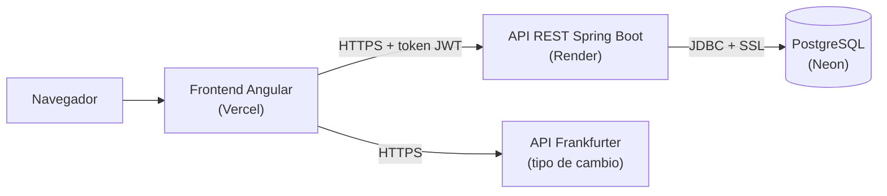
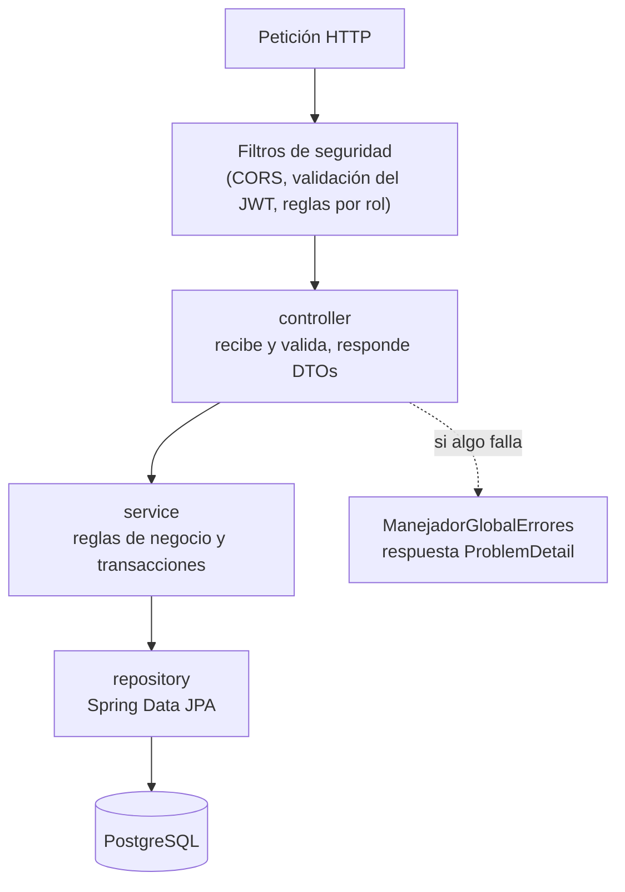
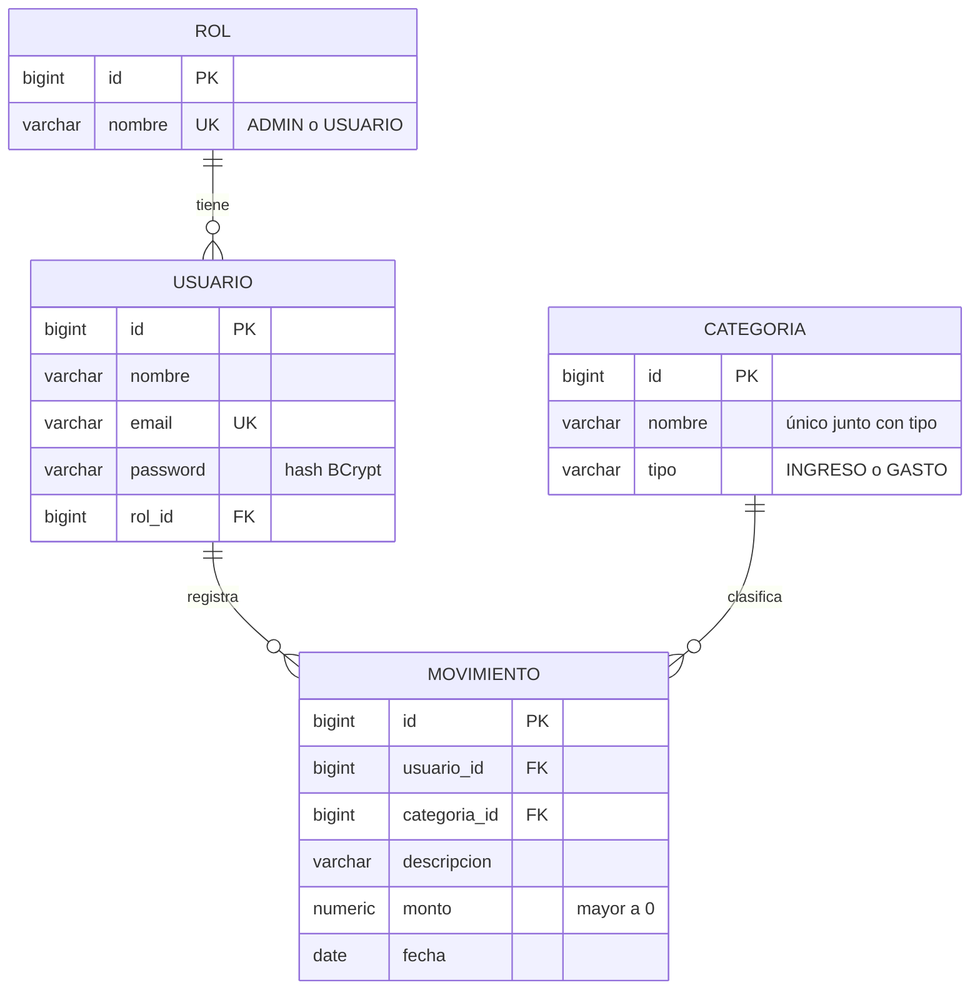

# GAMS Finanzas — Backend

API REST de **GAMS Finanzas**, una aplicación de finanzas personales para jóvenes y universitarios que
no llevan el control de sus gastos. Proyecto del curso **Desarrollo Full Stack** (UTP).

Frontend (Angular): <https://github.com/DiegoPorrasZela/GAMS-Finanzas>

## Tecnologías

- Java 21 y Spring Boot 4.1 (Web MVC, Data JPA, Validation)
- Spring Security con tokens JWT (HMAC-SHA256) y contraseñas con BCrypt
- PostgreSQL (Neon en la nube) con migraciones Flyway
- Maven (incluye `mvnw`, no hace falta instalarlo)

## Arquitectura



El backend sigue una **arquitectura en capas**: cada capa solo conoce a la de abajo.



```
controller/   Endpoints REST: reciben y validan la petición, devuelven DTOs
service/      Lógica y reglas de negocio, transacciones
repository/   Acceso a datos con Spring Data JPA
entity/       Tablas de la base de datos mapeadas con JPA
dto/          Objetos que entran y salen del API (nunca se expone una entidad)
exception/    Errores del negocio y su conversión a respuestas JSON (ProblemDetail)
config/       Seguridad (JWT, roles, CORS) y datos iniciales
```

## Seguridad

- **Autenticación:** `POST /api/auth/login` (o `/registro`) devuelve un **token JWT** firmado que dura 8 horas.
  El cliente lo envía en cada petición con el header `Authorization: Bearer <token>`. El servidor no guarda
  sesiones (stateless): la sesión es el token, y cerrar sesión es descartarlo.
- **Autorización por rol:** el token lleva el rol del usuario. `USUARIO` gestiona sus movimientos y ve las
  categorías; `ADMIN` además crea, edita y elimina categorías y gestiona usuarios.
- **Autorización por dueño:** el id del usuario sale del token, nunca del cuerpo de la petición. Un movimiento
  de otro usuario responde `404`, como si no existiera.
- Las contraseñas se guardan con **BCrypt**. Un token alterado (por ejemplo, cambiando el rol) se rechaza
  porque su firma deja de ser válida.
- Ningún secreto está en el repositorio: la conexión a la base de datos, la clave de los tokens y la
  contraseña del administrador llegan por variables de entorno.

## Patrones de diseño

| Patrón | Dónde se usa | Para qué |
|---|---|---|
| Arquitectura en capas (MVC) | `controller` → `service` → `repository` | Cada capa tiene una sola responsabilidad |
| Repository | `repository/*Repository` (Spring Data JPA) | Acceder a los datos sin escribir SQL en la lógica |
| DTO | `dto/*Request`, `dto/*Response` | No exponer las entidades ni la contraseña; validar la entrada |
| Factory Method | `MovimientoResponse.desde(...)`, `UsuarioResponse.desde(...)` | Crear un DTO a partir de una entidad en un solo lugar |
| Builder | `JwtClaimsSet.builder()` en `JwtService` | Armar el token dato por dato |
| Inyección de dependencias / Singleton | Constructores de servicios y controladores (beans de Spring) | Bajo acoplamiento; una sola instancia de cada servicio |
| Chain of Responsibility | Cadena de filtros de `SecurityConfig` | Cada filtro (CORS, JWT, permisos) decide si la petición sigue |
| Strategy | `PasswordEncoder` (BCrypt), `JwtEncoder`/`JwtDecoder` | Cambiar el algoritmo sin tocar el código que lo usa |
| Template Method | `ManejadorGlobalErrores` extiende `ResponseEntityExceptionHandler` | Reutilizar el manejo de errores de Spring y cambiar solo los mensajes |

## Base de datos (3FN)

El esquema está en [`src/main/resources/db/migration`](src/main/resources/db/migration) y Flyway lo crea al iniciar.



| Tabla | Columnas |
|---|---|
| `rol` | id, nombre |
| `usuario` | id, nombre, email (único), password (BCrypt), rol_id → rol |
| `categoria` | id, nombre, tipo (`INGRESO`/`GASTO`); nombre + tipo es único |
| `movimiento` | id, usuario_id → usuario, categoria_id → categoria, descripcion, monto (> 0), fecha |

Cómo cumple cada forma normal:

- **1FN:** todos los valores son atómicos (un solo dato por columna) y cada tabla tiene clave primaria.
- **2FN:** las claves primarias son simples (`id`), así que ningún atributo depende de una parte de la clave.
- **3FN:** ningún atributo depende de otro que no sea la clave. `movimiento` no guarda el tipo (lo toma de su
  categoría) y `usuario` no guarda el nombre del rol (solo `rol_id`). Guardarlos sería una dependencia
  transitiva y podría dejar datos contradictorios.

## Endpoints

| Método | Ruta | Acceso | Descripción |
|---|---|---|---|
| POST | `/api/auth/registro` | Público | Crear cuenta (rol USUARIO); devuelve el token |
| POST | `/api/auth/login` | Público | Iniciar sesión; devuelve el token |
| GET | `/api/auth/yo` | Con sesión | Datos del usuario de la sesión |
| GET | `/api/estado` | Público | Comprobar que el API está en línea |
| GET | `/api/movimientos` | Con sesión | Mis movimientos, del más reciente al más antiguo |
| GET | `/api/movimientos/{id}` | Con sesión | Uno de mis movimientos |
| POST | `/api/movimientos` | Con sesión | Registrar un movimiento |
| PUT | `/api/movimientos/{id}` | Con sesión | Editar uno de mis movimientos |
| DELETE | `/api/movimientos/{id}` | Con sesión | Eliminar uno de mis movimientos |
| GET | `/api/categorias` | Con sesión | Listar categorías |
| POST | `/api/categorias` | ADMIN | Crear categoría |
| PUT | `/api/categorias/{id}` | ADMIN | Editar categoría (no se puede cambiar el tipo si ya tiene movimientos) |
| DELETE | `/api/categorias/{id}` | ADMIN | Eliminar categoría (solo si no tiene movimientos) |
| GET | `/api/usuarios` | ADMIN | Listar usuarios |
| DELETE | `/api/usuarios/{id}` | ADMIN | Eliminar un usuario y sus movimientos (no la propia cuenta) |

Ejemplo de cuerpo para crear un movimiento:

```json
{ "descripcion": "Menú del almuerzo", "monto": 15.50, "fecha": "2026-11-08", "categoriaId": 6 }
```

Los errores se devuelven en formato [ProblemDetail](https://www.rfc-editor.org/rfc/rfc9457) con el código HTTP
correspondiente: `400` datos inválidos (con un mensaje por campo), `401` sin sesión o credenciales incorrectas,
`403` el rol no tiene permiso, `404` no existe y `409` regla de negocio.

## Cómo ejecutar

Requisitos: JDK 21 y una base de datos PostgreSQL (local o en [Neon](https://neon.tech)).

1. Copia `.env.example` como `.env` y completa los datos de conexión y `JWT_SECRETO`.
2. Ejecuta:

   ```bash
   ./mvnw spring-boot:run        # Windows: mvnw.cmd spring-boot:run
   ```

3. El API queda en <http://localhost:8080/api>.

Al iniciar se crean dos usuarios si no existen:

- `admin@gams.pe` (ADMIN): su contraseña es la de `ADMIN_PASSWORD`. Si se cambia esa variable, la
  contraseña se actualiza en el siguiente inicio.
- `demo@gams.pe` / `demo123` (USUARIO, con movimientos de ejemplo): cuenta pública para probar la aplicación.
